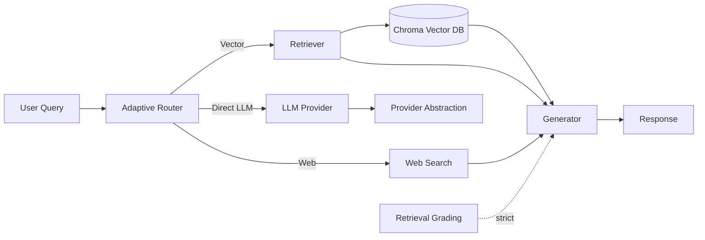
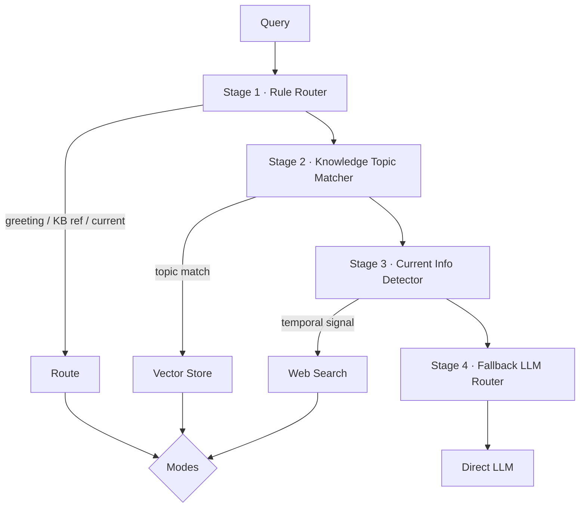
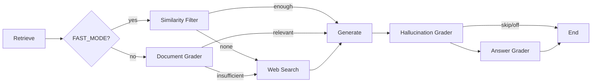

<div align="center">

# ⚡ Efficient Adaptive RAG


**A provider-agnostic, cost-efficient Retrieval-Augmented Generation framework.**

Minimize unnecessary LLM calls. Maximize answer quality.

</div>

---

## 📖 Overview

**Efficient Adaptive RAG** is a Retrieval-Augmented Generation framework designed for **low latency** and **cost-efficient inference**. Instead of asking an LLM to decide where every query should go, it runs a cheap, **four-stage adaptive router** that only invokes the LLM when deterministic rules are insufficient.

The result is a single system that gracefully routes across **three execution paths** — *Direct LLM*, *Vector Database* (RAG), and *Web Search* — using the cheapest decision mechanism available at every step.

### 🎯 Core Philosophy

| Principle | Why it matters |
|-----------|----------------|
| 🚀 Reduce latency | Deterministic routing finishes in microseconds, not LLM round-trips |
| 💰 Reduce inference cost | Fewer calls → lower spend, especially on every-day queries |
| ⚡ Reduce unnecessary LLM calls | LLM routing is a *fallback*, never the default |
| ✅ Keep answer quality high | Retrieval grounds answers; web search fills the freshness gap |
| 🔌 Remain provider agnostic | Swap Gemini, OpenAI, OpenRouter, or Ollama with one env var |
| 🧩 Remain modular | Graph nodes, chains, routers and providers are cleanly separated |

---

## ✨ Key Features

<details>
<summary><b>✅ Efficient Adaptive Routing</b> — four deterministic stages, LLM last</summary>

| # | Stage | Mechanism | LLM? |
|---|-------|-----------|------|
| 1 | **Rule Router** | Greetings, knowledge-base references, current-information keywords | ❌ |
| 2 | **Knowledge Topic Matcher** | Keyword + optional embedding match against the corpus topics | ❌ |
| 3 | **Current Information Detector** | Temporal/live/price signal re-check | ❌ |
| 4 | **Fallback LLM Router** | Structured LLM decision | ✅ last |

</details>

### ✅ Three Routing Modes
- 🧠 **Direct LLM** — greetings, general knowledge, coding, creative writing.
- 📚 **Vector Database** — questions grounded in the uploaded knowledge base.
- 🌐 **Web Search** — current, time-sensitive, or real-time information.

### ✅ Fast Mode — One LLM Call
```
Retrieve
   ↓
Similarity Filtering   (Chroma relevance score, no LLM)
   ↓
Generation
```

### ✅ Strict Mode — Full Validation Pipeline
```
Retrieve
  ↓
Document Validation     (LLM relevance grader)
  ↓
Generation
  ↓
Hallucination Validation
  ↓
Answer Validation
```

### ✅ Multi-Provider


### ✅ Persistent Vector Database
Ingestion is **separated** from runtime — build the store once, query many times.

### ✅ Execution Metadata
Every run records: **route** · **execution time** · **provider** · **model** · **retrieved documents** · **web search usage** · **validation results** · **LLM call count**.

---

## 🏗️ Architecture

### System Architecture


### Routing Architecture


### Execution Pipeline


---

## 📂 Project Structure

```text
.
├── main.py                        # 🖥️ Interactive CLI chatbot
├── graph/api.py                   # 🔌 Public programmatic API (query, metadata)
├── examples_metadata.py           # 📊 Metadata usage example
├── api_example.py                 # 📦 API example
├── ingestion.py                   # 🏗️ Build & persist Chroma vector store
├── vectorstore_config.py          # 📍 Chroma path + validation helpers
├── retrieval.py                   # 🔎 Retriever + score-based retrieval
├── embedding_provider.py          # 🧬 Embedding model wiring
├── jina_embeddings.py             # 📐 Jina embeddings adapter
├── llm_provider.py                # 🧩 Provider-agnostic LLM access
├── model.py                       # 🧱 Shared data / config models
├── requirements.txt               # 📦 Dependencies
│
├── graph/
│   ├── graph.py                   # 🕸️ LangGraph workflow + stats printer
│   ├── config.py                  # ⚙️ FAST_MODE / STRICT_MODE / graders
│   ├── consts.py                  # 🏷️ Node-name constants
│   ├── state.py                   # 🧬 GraphState definition
│   ├── execution_metadata.py      # 📊 Metadata + ExecutionResult models
│   ├── llm_counter.py            # 🔢 LLM-call counter
│   ├── routing/
│   │   ├── adaptive_router.py     # 🧭 Four-stage efficient router
│   └── chains/
│       ├── generation.py          # 🖊️ RAG + multi-section web chains
│       ├── router.py              # 🔀 Structured-output LLM router
│       ├── router_prompts.py      # 📋 Router decision criteria
│       ├── retrieval_grader.py    # 📄 Document relevance grader
│       ├── hallucination_grader.py# 🧠 Hallucination validator
│       ├── answer_grader.py       # ✅ Answer quality validator
│       ├── direct_generation.py   # ⚡ Direct-response chain
│   └── nodes/
│       ├── retrieve.py            # 🔎 Retrieve (+ FAST filter)
│       ├── grade_documents.py     # 📄 Grade document relevance
│       ├── generate.py            # 🖊️ Generate RAG / web answers
│       ├── web_search.py          # 🌐 Multi-result web search
│       └── direct_llm.py         # 🧠 Direct LLM response
│
├── providers/
│   ├── base.py                    # 🏗️ LLMProvider interface
│   ├── factory.py                 # 🔧 Provider factory + structured output
│   ├── gemini.py                  # 📘 Gemini provider
│   ├── openai.py                  # 🐦 OpenAI provider
│   ├── ollama.py                  # 🫙 Ollama provider
│   └── openrouter.py              # 🔀 OpenRouter provider
│
└── test_*.py                      # 🧪 Unit test suites
```

---

## 🚀 Installation

### 1. Clone & prepare
```bash
git clone https://github.com/yourorg/efficient-adaptive-rag.git
cd efficient-adaptive-rag
python -m venv venv
source venv/bin/activate          # Windows: venv\Scripts\activate
pip install -r requirements.txt
```

### 2. Environment variables
```bash
cp .env.example .env
```

| Variable | Description | Required |
|----------|-------------|:--------:|
| `LLM_PROVIDER` | `openrouter`, `gemini`, `openai`, or `ollama` | ✅ |
| `OPENROUTER_API_KEY` | API key for OpenRouter (if provider = openrouter) | provider |
| `OPENROUTER_MODEL` | e.g. `openrouter/free` | provider |
| `GOOGLE_API_KEY` | API key for Gemini (if provider = gemini) | provider |
| `OPENAI_API_KEY` | API key for OpenAI (if provider = openai) | provider |
| `OLLAMA_MODEL` | local Ollama model name (if provider = ollama) | provider |
| `JINA_API_KEY` | API key for `jina-embeddings-v3` | ✅ |
| `TAVILY_API_KEY` | API key for Tavily web search | ✅ |
| `FAST_MODE` | `true` / `false` (see Configuration) | ⚪ |
| `SIMILARITY_THRESHOLD` | Chroma relevance cutoff (default `0.5`) | ⚪ |

> ⚠️ Keep `.env` out of version control — it is git-ignored.

### 3. Run ingestion (build the knowledge base)
```bash
source venv/bin/activate
python ingestion.py
```
This loads the source documents, splits them into chunks, embeds them with
`jina-embeddings-v3`, and persists a **Chroma** vector store to `.chroma/`.

### 4. Run the chatbot
```bash
python main.py
```

---

## 💬 Usage

### Interactive terminal
```bash
$ python main.py
============================================================
🤖 Agentic Adaptive RAG
============================================================
Welcome! Ask me anything or type 'quit', 'exit' or 'bye' to stop.
------------------------------------------------------------

💬 You: Hello
```

### Programmatic API
```python
from graph.api import query, query_with_metadata

# Just the answer
print(query("What is planning in AI agents?"))

# Answer + full execution metadata
result = query_with_metadata("What is the latest LangGraph release?")
print(result.generation)
print("Route:", result.metadata.route)
print("Time:", result.metadata.execution_time_seconds, "s")
```

---

## 🧭 Routing Examples & Logs

### 1. Direct LLM
```
💬 You: Hello
📋 PROCESSING NEW QUERY
Rule Router
  Matched greeting: 'hello'
↓
direct_llm
🤖 Bot: Hi there! How can I help you today?
```

### 2. Vector Store
```
💬 You: What is planning in AI agents?
Knowledge Router
  Matched planning topic
↓
retrieve
---RETRIEVE---
Documents passed to generation: 4
Using RAG generation chain
🤖 Bot: Planning in AI agents is the process of...
```

### 3. Web Search
```
💬 You: What happened in AI today?
Rule Router
  Matched current information: 'today'
↓
websearch
---WEB SEARCH---
Retrieved search results: 3
Titles:
  - 1. OpenAI releases new model
  - 2. Nvidia unveils AI chip
  - 3. EU passes AI regulation
1. OpenAI releases new model
   Summary ...
   (TechCrunch, 2026-08-07)
...
```

---

## ⚙️ Configuration

### FAST_MODE vs STRICT_MODE

```dotenv
FAST_MODE=true
```

| Mode | Pipeline | LLM calls |
|------|----------|-----------|
| **FAST_MODE=true** | Retrieve → Similarity Filter → Generate | **1** |
| **FAST_MODE=false** (default) | Retrieve → Doc Grader → Generate → Hallucination → Answer | multiple |

**FAST_MODE** trades the LLM validation pipeline for a **Chroma relevance-score
threshold**, keeping quality via grounded retrieval while cutting cost to a
single inference. When no document clears `SIMILARITY_THRESHOLD`, the system
seamlessly falls back to web search.

### Grading toggles (STRICT mode)
```env
ENABLE_HALLUCINATION_GRADING=true
ENABLE_ANSWER_GRADING=true
```
Set either to `false` to skip that validation stage. Both defaults keep the
full Strict pipeline active.

### Provider selection
```env
LLM_PROVIDER=openrouter
OPENROUTER_MODEL=openrouter/free
GOOGLE_API_KEY=...        # if LLM_PROVIDER=gemini
JINA_API_KEY=...          # always required for embeddings
```

| Env var | Purpose |
|---------|---------|
| `LLM_PROVIDER` | Chooses the model backend among OpenRouter / Gemini / OpenAI / Ollama |
| `OPENROUTER_MODEL` | Model id used by the OpenRouter provider |
| `GOOGLE_API_KEY` | Credentials for Gemini-backed inference |
| `JINA_API_KEY` | Credentials for the `jina-embeddings-v3` embedding model |
| `ENABLE_HALLUCINATION_GRADING` | Toggles the hallucination validator in STRICT mode |
| `ENABLE_ANSWER_GRADING` | Toggles the answer-quality validator in STRICT mode |

---

## 📊 Performance

Traditional **Adaptive RAG** routes every query through an LLM router, then runs
a multi-call validation pipeline. **Efficient Adaptive RAG** defers the LLM
decision to a last-resort fallback and offers a one-call Fast path.

| Metric | Traditional Adaptive RAG | Efficient Adaptive RAG |
|--------|--------------------------|------------------------|
| 🔀 Routing LLM calls | 1 (every query) | **0** for ~dominated rule/topic routes |
| 🔄 RAG pipeline LLM calls | 4+ (router + grader + generator + validators) | **1** (Fast Mode) |
| ⏱️ Routing latency | ~500 ms – 2 s | **< 5 ms** deterministic |
| ⏱️ Typical end-to-end | seconds | **~70–85% lower** routing + Fast path |
| 💸 Execution cost / query | High (multi-call) | **Low (single inference)** |

*Numbers are indicative; actual figures depend on provider latency and pricing.*

---

## 🧪 Tests

Each subsystem is covered by an offline, deterministic test suite:

```bash
python test_adaptive_router.py            # 15/15 routing criteria
python test_retrieval_grader_resilience.py # grader None/error fallback
python test_fast_mode.py                  # FAST_MODE config + filtering
python test_web_generation.py             # web multi-section generation
pytest graph/chains/tests -q              # chain components
```

---

## 🗺️ Roadmap

| Status | Feature |
|--------|---------|
| 🔜 | **Streaming responses** — token-by-token output |
| 🔜 | **Tool calling** — native function/tool integrations |
| 🔎 | **Hybrid search** — lexical + dense retrieval in one query |
| 🌐 | **REST API** — HTTP endpoint layer |
| 📊 | **Performance dashboard** — live route/cost telemetry |
| 🤖 | **Multi-agent support** — task-specialized subagents |
| 🎨 | **UI** — web rendering for the terminal chat |
| 🧪 | **Evaluation suite** — offline metric harness |

---

Made with ⚡ for low-latency, low-cost Retrieval-Augmented Generation.